# DeepSeek Harness 完整学习手册

> 本手册面向第一次接触 `deepseek-harness` 的开发者，把项目简介、总体架构、核心功能原理与开发实践步骤整理成一份可通读的文档。文中所有文件引用都使用相对路径链接，可直接点击跳转到仓库对应文件。

## 阅读导航

- [项目简介](#项目简介)
- [总体架构](#总体架构)
- [核心功能原理](#核心功能原理)
- [开发实践步骤](#开发实践步骤)
- [关键概念源码实现详解](#关键概念源码实现详解)
- [文件索引](#文件索引)
- [命令速查](#命令速查)

---

## 项目简介

### 一句话概括

DeepSeek Harness（CLI 名称 `dsh`）是 DeepSeek AI 开源的 **Agent Harness**：一个构建在 [Cordis](https://github.com/cordiverse/cordis) 之上的、**一切都是插件（everything-is-a-plugin）** 的智能体运行时骨架。模型适配器、工具注册表、会话日志、文件系统、Shell、Agent 循环本身，都是可替换、可组合的插件。

### 它解决什么问题

- **能力可替换**：换 LLM adapter、换沙箱 provider、换工具后端，不需要改 Agent 循环。
- **一切可扩展**：新能力通过挂载插件进入系统，而不是改核心代码。
- **可观测可回放**：任何到达模型请求的内容都能从会话日志重建（“模型可见即已记录”）。
- **多形态交付**：同一套插件树可装配为 Web UI、Headless CLI、SDK JSON-RPC、ACP 自动化服务。

### 技术底座

| 项 | 值 |
| --- | --- |
| 框架 | Cordis（vendored 到 [`vendor/`](../vendor/README.md)） |
| 范式 | everything-is-a-plugin |
| 语言 | TypeScript，ESM only，`strict: true` |
| 运行时 | Node.js `>= 24.9`，Corepack + pnpm `11.28.5` |
| 包管理 | pnpm workspaces，所有包为 `@deepseek-ai/dsh-*` |
| 当前版本 | `0.2.2-alpha.2`（developer preview，兼容性会快速破坏性变更） |

来源：[`README.md`](../README.md)、[`package.json`](../package.json)。

### 运行形态（Profile）

Profile 是“一组有序 bundle + 补丁”的命名组合，装配出不同产品形态：

- `web`：默认 Web UI，`npx @deepseek-ai/dsh web`。
- `headless`：一次性任务运行器，`pnpm dsh --profile headless "task"`。
- `sdk` / `sdk-minimal`：SDK JSON-RPC 服务。
- `acp`：仅自动化的 Agent Client Protocol 服务。

它们共享第一层 [`dsh-base`](../packages/bundle/base/README.md)（模型适配器、工具、持久化、沙箱与审批策略、设置、凭据、遥测）。

### 从源码运行

```sh
git clone https://github.com/deepseek-ai/deepseek-harness.git
cd deepseek-harness
pnpm install
pnpm run build
pnpm dsh web
```

真实 API 演示需要 `DEEPSEEK_API_KEY`（可放在根目录 `.env`）；Cordis 教程本身无需 key。

---

## 总体架构

### 一切都是插件

`dsh` 没有需要打补丁的“特权核心”。每个功能都是一个挂在共享 `Context` 上的 Cordis 插件——包括模型适配器、工具注册表、会话日志和 Agent 循环本身。扩展系统的方式是“在旁边再挂一个插件”，而不是修改循环。

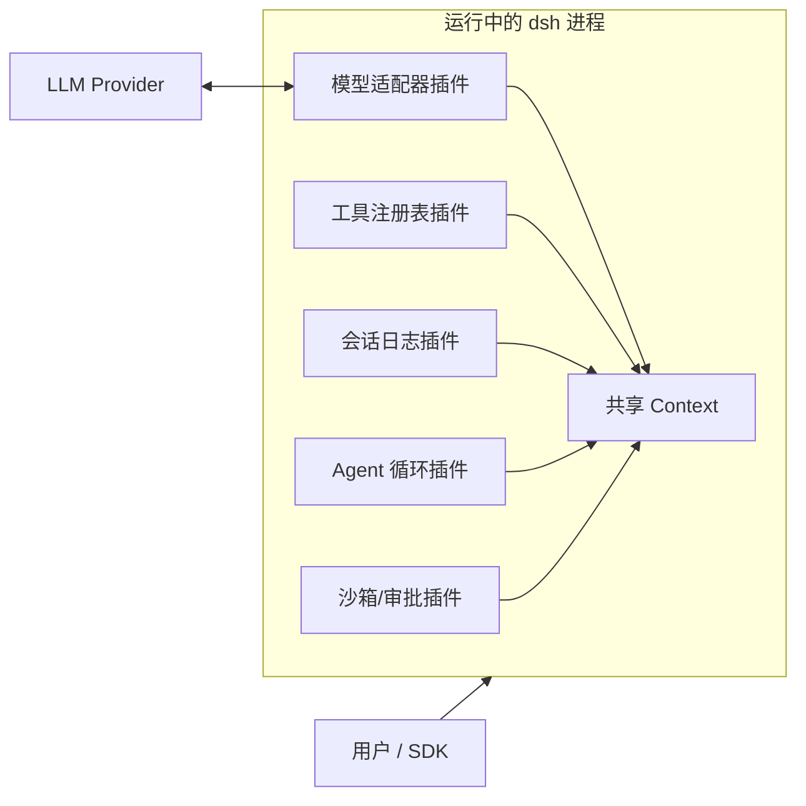

### 系统组成：Profile → Bundle → Plugin

运行中的 `dsh` 是一棵在启动时按“有序 layer”组合出来的插件树。

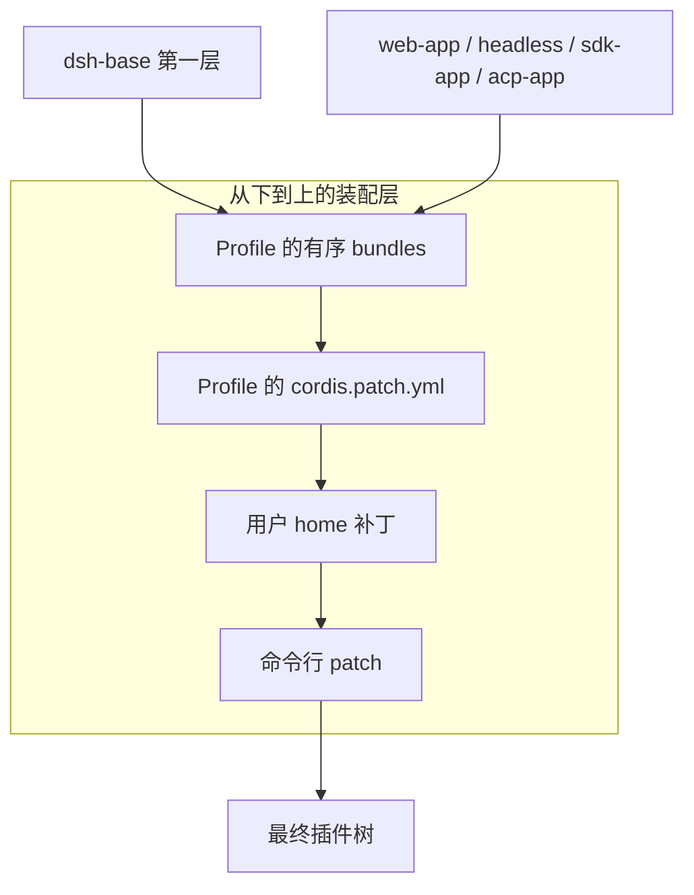

- **Profile**：命名组合，列出叠加的 bundle、持有树外插件，并保存用户的 `cordis.patch.yml`。
- **Bundle**：Cordis 配置行 + 所挂载代码的分发格式；其插入内容仍可被上层补丁覆盖。
- **Layer** 从上到下依次应用：profile 的有序 bundle → profile 补丁 → 用户 home 补丁 → 命令行 patch。

来源：[`docs/architecture.md`](../docs/architecture.md)、[`packages/bundle/README.md`](../packages/bundle/README.md)。

### 能力接缝的总体视图

一个可替换能力（seam）由三个角色组成，这是 `dsh` 保持“换 provider 即换产品”的核心机制。

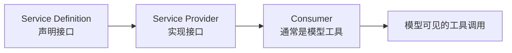

文件系统与子进程 provider 共享同一执行世界，因此把它们指向远程沙箱，Bash、PTY、LSP 会一起跟随，无需 provider 分叉。

来源：[`docs/capability-seams.md`](../docs/capability-seams.md)。

### 目录结构

```text
deepseek-harness/
├── apps/                 # 可运行应用：CLI、Web/Desktop 入口
├── packages/             # 全部 npm 包，按能力分组
├── vendor/               # vendored Cordis 源码 + 同步说明
├── native/               # 原生 Node addon（Landlock 沙箱等）
├── python/               # Python SDK 与打包运行时
├── docs/                 # 架构、子系统、生成图、教程、指南
├── scripts/              # 门禁与代码生成器（gen-* / verify-*）
├── snapshots/            # keyless 快照测试期望输出
├── benchmarks/           # 性能基准
├── website/              # VitePress 文档站点（docs 的投影）
└── tmp/                  # 被 gitignore 的临时/学习目录
```

完整分组说明见 [`packages/README.md`](../packages/README.md) 与 [`docs/architecture.md`](../docs/architecture.md)。

---

## 核心功能原理

### Cordis 五大核心思想

1. **插件是实现 `Service` 的对象**：可以是一个带 `inject` / `apply(ctx)` 的函数，也可以是 `Service` 子类。
2. **Context 是服务仓库**：服务占据稳定的 `ctx.<key>`（如 `ctx.tools`、`ctx.llm`、`ctx.sessions`），其他插件按 key 查找服务，而非 import 具体实现。
3. **用 `inject` 声明依赖**：插件声明需要哪些服务后，会等这些服务存在再挂载；加载顺序由服务依赖表达。
4. **用类型化事件通信**：通过 TypeScript 声明合并定义事件名，再按 `emit` / `waterfall` / `parallel` / `serial` / `bail` 派发。
5. **注册是可逆副作用**：提示段、工具 schema、adapter、provider、监听器都通过 `ctx.effect()` 或 `ctx.on()` 安装，插件卸载时自动回滚。

来源：[`docs/cordis-primer.md`](../docs/cordis-primer.md)。

### 事件派发模式

| 模式 | 是否 await | 派发顺序 | 是否有返回值 |
| --- | --- | --- | --- |
| `emit` | 否 | 注册顺序观察 | 无 |
| `waterfall` | 否 | 注册顺序观察 | 有（`next()` 委托/短路） |
| `parallel` | 是 | 并行观察 | 无 |
| `serial` | 是 | 注册顺序观察 | 有 |
| `bail` | 否 | 注册顺序直到第一个 bail | 有 |

关键规则：**waterfall 监听器必须调用 `next()` 才能委托**；不调用就短路整条链。事件模式属于公开契约，用 `@mode` 标注。

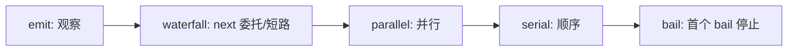

### 能力接缝（Seam）

一个接缝由 Service Definition、Service Provider、Consumer 三角色组成；一个包可以合并多个角色，但只实现一个角色不算接缝。

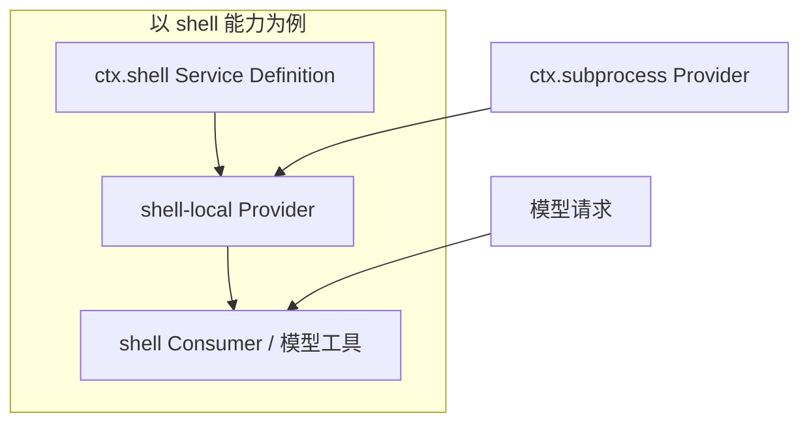

来源：[`docs/capability-seams.md`](../docs/capability-seams.md)、[`packages/shell/README.md`](../packages/shell/README.md)。

### Agent 生命周期：turn → step → tool call

一次模型调用被组织为 **turn（回合）→ step（步骤）→ tool call** 三层生命周期。持久回放事实写入 `session/event`，实时控制/状态走 `agent/*`。

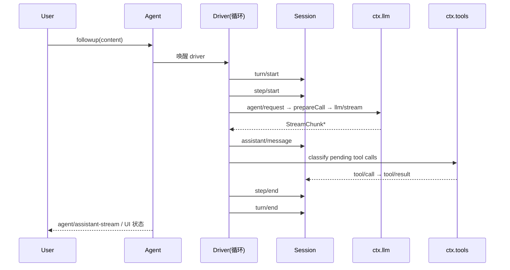

要点：

- 持久事件：`turn/start`、`step/start`、`system/message`、`user/message`、`assistant/message`、`tool/call`、`tool/result`、`turn/end`。
- 实时事件：`agent/status`、`agent/inbox/*`、`agent/request`、`agent/assistant-stream`。
- `system-prompt/assemble` 是 waterfall，按 step 的工具集组装提示。
- `agent/pre-step` 可权威拒绝或进入一个 step；`agent/turn-stopping` 是回合终点串行检查点。

来源：[`docs/agent-lifecycle.md`](../docs/agent-lifecycle.md)。

### 工具执行流水线

工具执行不改变循环，而是挂在一组共享事件上。

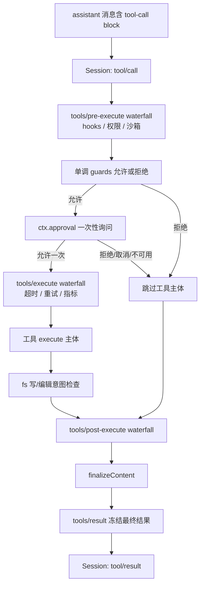

`tools/result` 观察的是不可变、可无损 JSON 化的最终结果，因此 hooks 能跨工具族工作，又不让工具耦合到某个策略服务。

来源：[`docs/tool-execution-pipeline.md`](../docs/tool-execution-pipeline.md)。

### 会话持久化：模型可见即已记录


- 任何到达模型请求的内容都必须能从日志重建；新增模型可见输入必须新增会话事件。
- `dsh-session-projection` 提供 `ctx.sessionProjections`，读取方通过 `snapshot()` 获取客户端视图。
- 会话日志版本由 `SESSION_FORMAT_VERSION` 机制管理，只有结构性格式变更才升版本。

来源：[`packages/core/session/README.md`](../packages/core/session/README.md)、[`packages/session/session-projection/README.md`](../packages/session/session-projection/README.md)。

### 关键服务与扩展点速查

| 目标 | 机制 |
| --- | --- |
| 加模型 provider | 在 `ctx.llm` 注册 adapter |
| 加模型可见能力 | 注册到 `ctx.tools`，schema 加入提示组装 |
| 给某会话换能力集 | 组合 agent preset（服务行需 `isolate` realm） |
| 加 shell 执行 | 注册 `ctx.shell` 后端（本地实现经 `ctx.subprocess` 派生） |
| 加人类命令 | 注册到 `ctx.commands` |
| 加后台任务 | 注册到 `ctx.jobs` |
| 加文件访问/策略 | 注册 `ctx.fs` provider 或监听 `fs/*` 事件 |
| 隔离子进程 | 使用 `ctx.sandbox` 后端，在派生前包装 argv |
| 拦截请求/工具/回合 | 监听 `agent/*` 或 `tools/*` 事件 |
| 加模型可见上下文 | 调用 `agent.inject()` |
| 加持久会话状态 | 扩展 `SessionEventMap`，从日志渲染与回放 |

---

## 开发实践步骤

### 阶段 0：把环境跑起来

```sh
git clone https://github.com/deepseek-ai/deepseek-harness.git
cd deepseek-harness
corepack enable          # 启用 pnpm 11.28.5
pnpm install             # 安装依赖并配置 Lefthook hooks
pnpm run typecheck       # 首次克隆后跑一次
pnpm run build
pnpm dsh web             # 起 Web UI（默认 http://127.0.0.1:3080）
```

前提：Node.js `>= 24.9` 且支持 TypeScript type stripping；不要用 `NODE_OPTIONS=--no-experimental-strip-types`。详见 [`docs/development.md`](../docs/development.md)。

### 阶段 1：先懂 Cordis

- 概念速查：读 [`docs/cordis-primer.md`](../docs/cordis-primer.md)。
- 动手教程：从 [`docs/cordis-tutorial/index.md`](../docs/cordis-tutorial/index.md) 开始，逐章完成 7 个可运行示例：

```text
1. 第一个插件        —— 插件是一个函数，loader 挂载它
2. 生命周期与副作用  —— 注册随插件卸载被撤销
3. 服务             —— 在 ctx 上暴露能力，用 inject 依赖
4. 事件             —— 类型化事件、广播、waterfall 短路
5. 配置             —— 从 cordis.yml 校验配置，坏输入响亮失败
6. 组合与 HMR       —— 配置作为插件树、热重载、诊断未加载
7. 进入 harness     —— 对真实服务注册一个模型可调工具
```

教程目录就是本仓库的 `tmp/cordis-tutorial/`（gitignored），每个章节运行：

```sh
cd tmp/cordis-tutorial
node --import tsx ../../vendor/cordis/bin.js
```

### 阶段 2：读懂整体架构

- 必读 [`docs/architecture.md`](../docs/architecture.md)：profile/bundle、能力接缝、Agent 循环、会话日志、扩展点。
- 看图：`docs/agent-lifecycle.md`、`docs/tool-execution-pipeline.md`、`docs/capability-seams.md`。
- 看包图：`docs/module-graph.md`、`docs/graph-atlas.md`。

### 阶段 3：掌握包布局

- 总地图读 [`packages/README.md`](../packages/README.md)。
- 重点先看 `packages/core/`：`agent`、`agent-loop`、`session`、`tools`、`system-prompt`。
- 看一个接缝全家桶，推荐 `shell`：Service Definition → 本地 provider → 模型工具 Consumer。

### 阶段 4：真实运行与最小改动

```sh
pnpm dsh --profile headless "summarize this workspace"   # 需要 DEEPSEEK_API_KEY
pnpm run dev:web                                          # Web 热重载开发
```

最小改动练习（都带分步指南）：

- [`docs/cookbook/adding-a-tool.md`](../docs/cookbook/adding-a-tool.md)：加一个模型工具。
- [`docs/cookbook/adding-an-llm-adapter.md`](../docs/cookbook/adding-an-llm-adapter.md)：加 LLM adapter。
- [`docs/cookbook/adding-a-package.md`](../docs/cookbook/adding-a-package.md)：加 npm 包。
- [`docs/cookbook/adding-a-settings-card.md`](../docs/cookbook/adding-a-settings-card.md)：加设置页。

### 阶段 5：按仓库规范贡献

- 改 `packages/` 前必读 [`docs/architecture.md`](../docs/architecture.md)；文档改动遵循 [`docs/AGENTS.md`](../docs/AGENTS.md)。
- 每次提交前跑“最小覆盖集”，不要默认全量测试：
  - 行为改动 → 聚焦单测 + 快照。
  - 文档 → `pnpm run doc-sync`。
  - 发布路径/构建产物 → `pnpm run build` + `pnpm run hygiene`。
- 非平凡改动必须在同一 PR 写 Agent Note，见 [`.agents/notes/README.md`](../.agents/notes/README.md)。

### 学习路线图

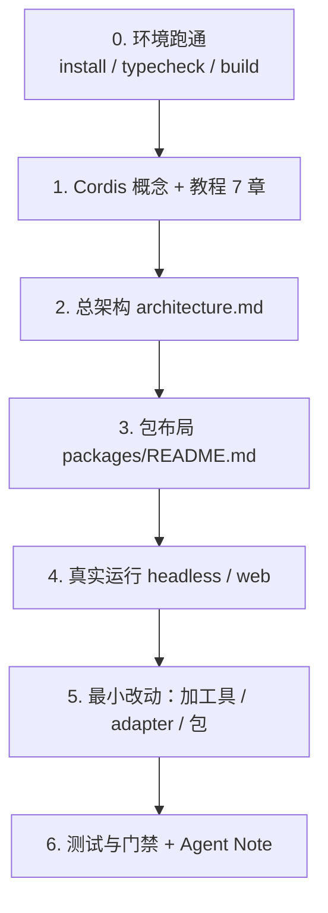

---

## 文件索引

常用入口文件与目录（相对本手册的路径，点击可跳转）：

- 项目总览：[`README.md`](../README.md)
- 架构：[`docs/architecture.md`](../docs/architecture.md)
- Cordis 概念：[`docs/cordis-primer.md`](../docs/cordis-primer.md)
- Cordis 教程：[`docs/cordis-tutorial/index.md`](../docs/cordis-tutorial/index.md)
- 开发指南：[`docs/development.md`](../docs/development.md)
- 测试策略：[`docs/testing.md`](../docs/testing.md)
- 能力接缝：[`docs/capability-seams.md`](../docs/capability-seams.md)
- Agent 生命周期：[`docs/agent-lifecycle.md`](../docs/agent-lifecycle.md)
- 工具流水线：[`docs/tool-execution-pipeline.md`](../docs/tool-execution-pipeline.md)
- 包间依赖图：[`docs/module-graph.md`](../docs/module-graph.md)
- 文档图索引：[`docs/graph-atlas.md`](../docs/graph-atlas.md)
- 包分组：[`packages/README.md`](../packages/README.md)
- 核心包：[`packages/core/README.md`](../packages/core/README.md)
- 扩展指南目录：[`docs/cookbook/`](../docs/cookbook/)
- 子系统参考：[`docs/subsystems/`](../docs/subsystems/)
- Agent Notes：[`.agents/notes/README.md`](../.agents/notes/README.md)
- 仓库门禁脚本：[`scripts/`](../scripts/)

---

## 命令速查

| 命令 | 用途 |
| --- | --- |
| `pnpm run typecheck` | TypeScript 全量类型检查 |
| `pnpm run lint` | oxlint |
| `pnpm run test` | vitest 单元测试 |
| `pnpm run test:coverage` | CI 覆盖率门禁 |
| `pnpm run test:snapshot` | keyless 快照测试 |
| `pnpm run build` | tsc + tsdown 产物构建 |
| `pnpm run hygiene` | knip + publint + workspace 约束 |
| `pnpm run doc-sync` | 文档全部门禁 |
| `pnpm run duplication` | 跨文件 TS 克隆检测 |
| `pnpm dsh web` | 从源码启动 Web UI |
| `pnpm dsh --profile headless "task"` | 一次性 Headless 任务 |

---

## 关键概念源码实现详解

本节把前文概念落到源码，标注了可直接跳转的文件与行号（路径相对本手册，位于 `learnings/` 下，故以 `../` 开头）。

### 1. 插件、Service 与 Context 的实现

Cordis 的核心类型都在 vendored 运行时 [`vendor/cordis/src/`](../vendor/cordis/src/)。

- [`Service`](../vendor/cordis/src/service.ts#L11) 是所有服务的抽象基类；子类在构造器里调用 `super(ctx, name)`，最终通过 `ctx.reflect.provide(name, self, check)` 完成注册（[service.ts#L42-L58](../vendor/cordis/src/service.ts#L42)）。
- [`Context`](../vendor/cordis/src/context.ts#L42) 的构造器安装四个内置服务：`reflect`（反射/提供）、`registry`（插件注册）、`events`（事件总线）、`logger`（[context.ts#L70-L84](../vendor/cordis/src/context.ts#L70)）。
- 插件入口有三种形状：函数、`{ apply(ctx, config) }` 对象、`Service` 子类，声明见 [`registry.ts#L91-L110`](../vendor/cordis/src/registry.ts#L91)；对象插件的判定是“有 `apply` 函数”（[registry.ts#L9](../vendor/cordis/src/registry.ts#L9)）。
- `RegistryService.plugin()` 归一化插件形状、创建 Fiber 并启动，[registry.ts#L307-L330](../vendor/cordis/src/registry.ts#L307)。

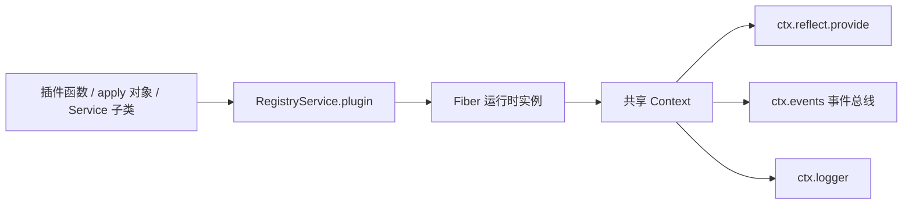

### 2. 依赖注入与配置校验

- 依赖声明类型 [`Inject`](../vendor/cordis/src/registry.ts#L19)：数组表示“需要这些服务”，对象表示“服务名 → intercept 配置”。
- [`Inject.resolve()`](../vendor/cordis/src/registry.ts#L71) 把数组/对象/类继承的 inject 元数据归一化为服务名映射；`@Inject()` 装饰器最终调用 `ctx.inject()`，[registry.ts#L37-L59](../vendor/cordis/src/registry.ts#L37)。
- 配置校验在 Fiber 启动前执行：[`resolveConfig()`](../vendor/cordis/src/fiber.ts#L50) 用 standard-schema 校验，失败抛 [`ValidationError`](../vendor/cordis/src/fiber.ts#L19)。这正是“坏配置响亮失败”的实现点。

### 3. 可逆副作用 `ctx.effect()` 的实现

- [`Effect`](../vendor/cordis/src/fiber.ts#L83) 接受一个 disposer、一个 Promise<disposer>，或产出多个 disposer 的 iterable。
- [`Fiber.effect()`](../vendor/cordis/src/fiber.ts#L424) 立即执行 effect body，把返回的 disposer 收集进 `disposables`；卸载时**按注册逆序**执行（[fiber.ts#L433-L448](../vendor/cordis/src/fiber.ts#L433)）。
- `ctx.on()` 注册监听器同样经由 `ctx.fiber.effect()`，卸载时自动 `unregister`（[events.ts#L263-L269](../vendor/cordis/src/events.ts#L263)、[events.ts#L294-L307](../vendor/cordis/src/events.ts#L294)）。

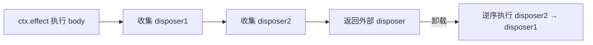

### 4. 事件派发实现

五种派发模式集中在 [`events.ts`](../vendor/cordis/src/events.ts) 的 [`EventsService`](../vendor/cordis/src/events.ts#L130)：

| 模式 | 实现方法 | 关键行为 |
| --- | --- | --- |
| `parallel` | [events.ts#L191](../vendor/cordis/src/events.ts#L191) | `Promise.allSettled` 并发执行，有错抛 `AggregateError` |
| `emit` | [events.ts#L203](../vendor/cordis/src/events.ts#L203) | 同步顺序执行，忽略返回值 |
| `serial` | [events.ts#L214](../vendor/cordis/src/events.ts#L214) | 顺序 await，首个 bail 值返回 |
| `bail` | [events.ts#L228](../vendor/cordis/src/events.ts#L228) | 同步顺序执行，首个 bail 值返回 |
| `waterfall` | [events.ts#L246](../vendor/cordis/src/events.ts#L246) | 洋葱式组合：`next()` 委托，`next()` 调两次报错 |

waterfall 的核心是闭包链：每次 `next()` 弹出下一个 listener，最终调用内置 `inner`（[events.ts#L248-L260](../vendor/cordis/src/events.ts#L248)）。bail 的判定规则是“返回值不是 null/false/undefined 即停止”（[events.ts#L12-L14](../vendor/cordis/src/events.ts#L12)）。

### 5. 能力接缝源码：以 `ctx.shell` 为例

- Service Definition：`declare module '@deepseek-ai/cordis'` 向 `Context` 声明 `shell`，抽象类 [`ShellExecutor extends Service`](../packages/shell/shell/src/index.ts#L64) 即接口（[shell/index.ts#L30](../packages/shell/shell/src/index.ts#L30)）。
- 请求/规格分层：模型可见的 [`ShellExecRequest`](../packages/shell/shell/src/types.ts#L61) 由 `resolve()` 填默认值、封顶后得到实现用的 [`ShellExecSpec`](../packages/shell/shell/src/types.ts#L111)；这正是“显式 resolve，而非 `run()` 里藏 `??` 默认值”的接缝模板。
- Provider 实现如 `bash-local`、`pwsh-local`、`bash-sandbox` 等挂到同一 `ctx.shell`；Consumer 是 `tool-bash` / `tool-bash-persistent` 等模型工具。

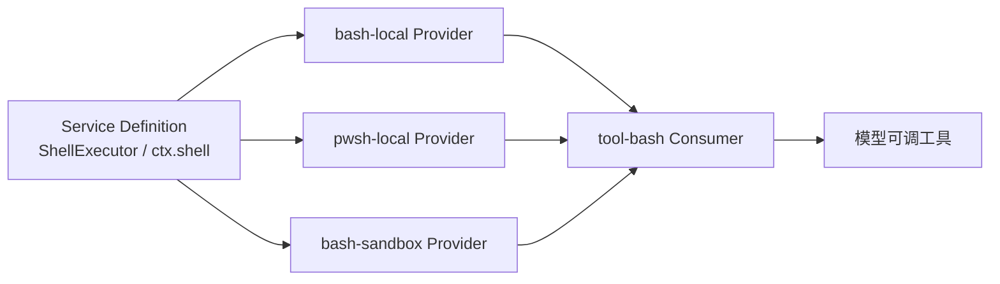

### 6. 工具注册与执行流水线源码

- [`ToolsService extends Service`](../packages/core/tools/src/index.ts#L99) 通过 [`register()`](../packages/core/tools/src/index.ts#L128) 注册工具定义并返回 disposer；同名工具在同一 scope 重复注册会抛错（[index.ts#L69](../packages/core/tools/src/index.ts#L69)）。
- 工具事件契约在 [`tools/src/events.ts`](../packages/core/tools/src/events.ts) 声明：`tools/pre-execute`（waterfall）、`tools/execute`（waterfall）、`tools/post-execute`（waterfall）、`tools/result`（emit）、`tools/change`（emit），见 [events.ts#L18-L56](../packages/core/tools/src/events.ts#L18)。
- 具体流水线在 [`ToolExecutionPipeline`](../packages/core/tools/src/pipeline.ts#L62)：`tools/pre-execute` 分发点 [pipeline.ts#L200](../packages/core/tools/src/pipeline.ts#L200)、`tools/execute` 分发点 [pipeline.ts#L300](../packages/core/tools/src/pipeline.ts#L300)、`finalizeContent` [pipeline.ts#L393](../packages/core/tools/src/pipeline.ts#L393)、`tools/result` [pipeline.ts#L409](../packages/core/tools/src/pipeline.ts#L409)、审批 [pipeline.ts#L436](../packages/core/tools/src/pipeline.ts#L436)。
- 执行器契约 [`ToolExecutor`](../packages/core/tools/src/executor.ts#L64) 只负责“描述 schema + 执行整批 + 可选写日志”，不拥有流水线策略。

### 7. Agent 循环源码：状态机与事件落账

默认驱动是 [`ReactLoopAgent`](../packages/core/agent-loop/src/agent.ts#L112)。其 `Phase` 状态机只有三种状态：

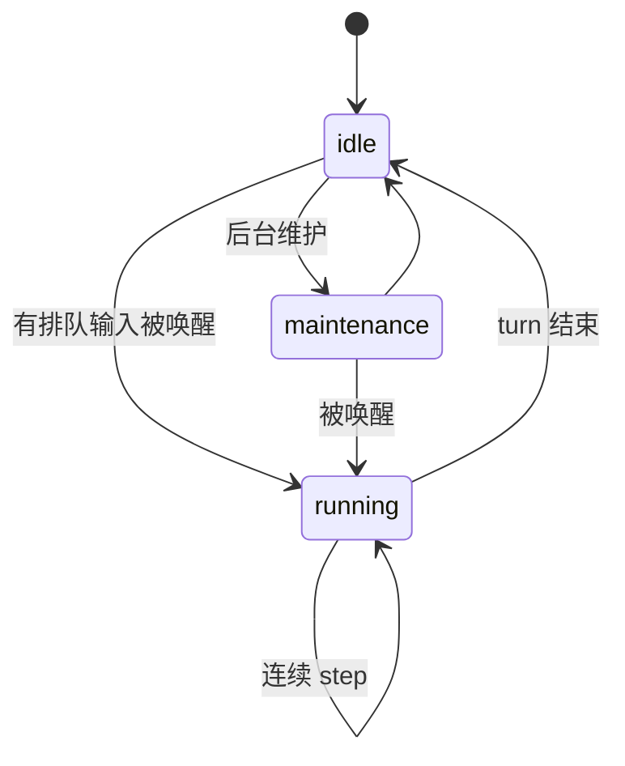

- 状态定义：[agent.ts#L53-L61](../packages/core/agent-loop/src/agent.ts#L53)；状态切换对外发 `agent/status`：[agent.ts#L160-L168](../packages/core/agent-loop/src/agent.ts#L160)。
- 持久事件直接 `session.append`：`turn/start` [agent.ts#L336](../packages/core/agent-loop/src/agent.ts#L336)、`step/start` [agent.ts#L361](../packages/core/agent-loop/src/agent.ts#L361)、`assistant/message` [agent.ts#L505](../packages/core/agent-loop/src/agent.ts#L505)、`turn/end` [agent.ts#L422](../packages/core/agent-loop/src/agent.ts#L422)。
- 请求前先走 `agent/request` waterfall 提出配置：[agent.ts#L631](../packages/core/agent-loop/src/agent.ts#L631)。

### 8. 会话日志与投影源码

- 日志格式版本：[`SESSION_FORMAT_VERSION = 4`](../packages/core/session/src/types.ts#L90)；事件类型表是 merge-extensible 的 [`SessionEventMap`](../packages/core/session/src/types.ts#L287)。
- 每个事件统一包装为 [`SessionEvent`](../packages/core/session/src/types.ts#L501)，带 `data`、序号与可选 `ignorable`（[types.ts#L519](../packages/core/session/src/types.ts#L519)）——这就是“不认识该事件类型的旧 reader 也可安全忽略”的机制。
- 投影接缝 [`ProjectionDefinition`](../packages/session/session-projection/src/index.ts#L81)：`init()` 给空日志初值（[index.ts#L92](../packages/session/session-projection/src/index.ts#L92)）、`apply()` 是纯 fold（[index.ts#L101](../packages/session/session-projection/src/index.ts#L101)）、`wire.view()` 生成客户端视图（[index.ts#L114](../packages/session/session-projection/src/index.ts#L114)）。框架负责订阅与水印缓存，域插件只写纯计算。

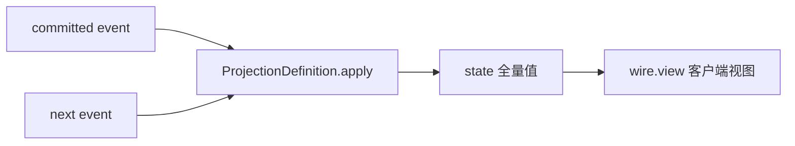
